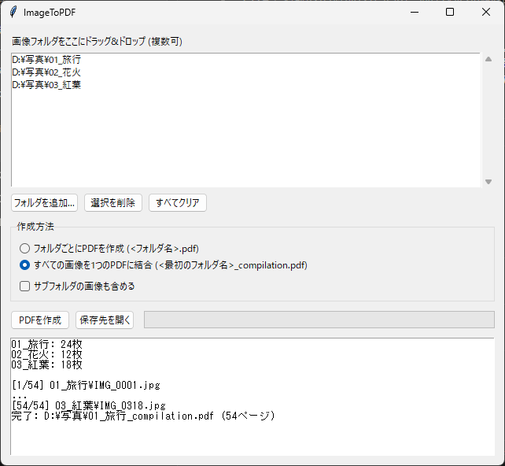

# ImageToPDF

フォルダ内の画像からPDFを作る、Windows用の小さなアプリです。
フォルダをウィンドウにドラッグ&ドロップして「PDFを作成」を押すだけで使えます。



## 機能

- **フォルダごとにPDFを作成**：フォルダ1つにつき `<フォルダ名>.pdf` を1つ作ります
- **すべての画像を1つのPDFに結合**：複数フォルダの画像をまとめて `<最初のフォルダ名>_compilation.pdf` にします
- ファイル名は数字を数として並べます（`img2` → `img10` の順）
- スマホ写真の回転情報（EXIF）を読んで、向きを補正します
- PNGなどの透過部分は白で塗りつぶします
- 対応形式：jpg / jpeg / png / bmp / gif / tif / tiff / webp

PDFは、元のフォルダと同じ場所に保存されます。

## ダウンロード（Pythonは不要）

[Releases](../../releases) から `ImageToPDF.exe` をダウンロードして、ダブルクリックで起動します。

> 署名のないexeなので、初回起動時に「WindowsによってPCが保護されました」と表示されることがあります。
> その場合は「詳細情報」→「実行」を押してください。

## Pythonから使う

```bash
pip install -r requirements.txt
python app.py
```

コマンドラインやバッチファイルからも使えます。

```bash
# フォルダごとにPDFを作成
python images_to_pdf.py フォルダ1 フォルダ2

# すべての画像を1つのPDFに結合
python images_to_single_pdf.py フォルダ1 フォルダ2
```

オプション：`-r`（サブフォルダも含める）、`--dpi 150`（解像度）、`-o 出力.pdf`（出力先）

`images_to_pdf.bat` / `images_to_single_pdf.bat` にフォルダをドラッグ&ドロップしても使えます。

## exeのビルド

```bash
pip install pyinstaller
python -m PyInstaller --onefile --windowed --name ImageToPDF --collect-all tkinterdnd2 app.py
```

`dist/ImageToPDF.exe` ができます。

## ライセンス

MIT
